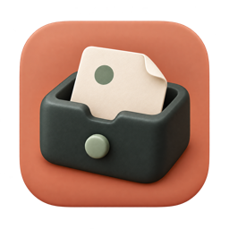

# 念匣 · NianBox

**把闪过的念头，先收进来。**

念匣住在 Mac 的菜单栏里。把鼠标移到屏幕角落，或按下 `Control–Option–Space`，写下一句话，再回到手头的事。可以先离线使用；接上自己的服务器后，也能通过 Hermes 访问同一份事项。

[**下载 Mac 版**](https://github.com/takboo/nianbox/releases/latest) · [开始使用](#开始使用) · [使用指南](docs/usage.md) · [English](README.en.md)

## 念匣能做什么

### 随手记下，再慢慢整理

只写标题就能保存。待办放在 Tasks，暂时不安排的想法放在 Backlog；需要时再调整优先级、开始处理或标记完成。完成的事项会留在历史里，直到你主动删除。

切换 Tasks／Backlog 时，尚未提交的文字分别保留，回来还能接着写。已保存的事项留在本机，断网也能继续记录。

### 保存和同步，一眼分清

菜单栏里的小纸张会回应录入与本地保存；同步完成另有短暂确认。连接失败、保存失败和删除冲突使用不同图形，并提供文字状态。

后台没有新内容时保持安静。开启 macOS 的“减少动态效果”后，状态用静态图形呈现。

### 在 Mac 和 Hermes 之间接着用

连接自托管的 NianBox Server 后，可以让 Hermes 帮你记录、查询或完成事项，再回到 Mac 查看。服务端独立运行；部署在常开设备上，Mac 关机时 Hermes 仍可访问。

数据由你自己的服务器保存，Mac 保留离线副本。同步中断时，已保存的更改会留在队列里等待重试。

## 开始使用

需要 **macOS 14 或更高版本**，支持 Apple Silicon 与 Intel Mac。

1. 从 [GitHub Releases](https://github.com/takboo/nianbox/releases/latest) 下载 Universal DMG，打开后将 NianBox 拖入 Applications。
2. 从应用程序启动。移到默认的屏幕右上角，或按 `Control–Option–Space` 打开快速记录。
3. 写下标题，按 Return 保存。从菜单栏或面板齿轮进入 Settings，可调整角落、透明效果和快捷键。

此开源构建使用临时签名，**尚未通过 Apple 公证**。首次下载可能被 macOS 拦截；核对下载来源后，可在系统设置 → 隐私与安全性中查看“仍要打开”。保留系统安全保护即可。

跨设备使用时，按[部署指南](docs/deployment.md)启动服务端，在 Mac 设置中填写地址与令牌，再[连接 Hermes](docs/hermes.md)。只在本机记录，无需部署服务器。

未提交的草稿仅保留在当前 App 会话中，退出前请保存。截止时间目前用于展示和查询，**不会到点通知**。

## 继续了解

- **日常操作与常见问题：** [使用指南](docs/usage.md)，或[提交 Issue](https://github.com/takboo/nianbox/issues)。
- **部署与数据备份：** [服务端部署](docs/deployment.md)、[Hermes 接入](docs/hermes.md)。
- **查看更新：** [版本记录](https://github.com/takboo/nianbox/releases)。
- **参与开发：** [开发指南](docs/development.md)、[工程文档索引](docs/README.md)与[验证范围](docs/verification.md)。

## 致谢与许可

念匣基于 Emanuele Di Pietro 的 [Peekaboo](https://github.com/Emanuele-web04/Peekaboo)，保留其 macOS 角落面板的交互与原始署名。NianBox 使用独立的本地数据目录与服务端，不会自动迁移旧 Peekaboo 数据。

项目采用 [MIT 许可证](LICENSE)。
